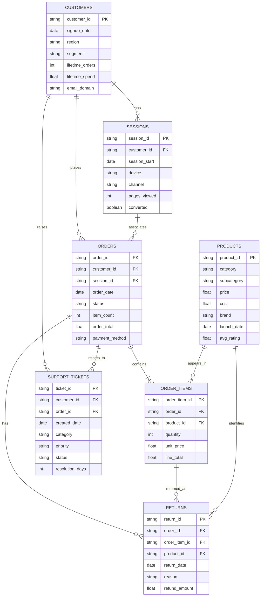

# E-commerce Lakehouse — Entity Relationship Diagram

## Relationship Overview

This ER diagram represents the proposed relationships between the
seven source tables of the e-commerce dataset.

Primary keys and foreign keys are candidate relationships inferred
from sample schemas and initial inspection. Full-dataset validation
is pending.

## Important Notes

- PK = Candidate Primary Key.
- FK = Candidate Foreign Key.
- `||` means exactly one.
- `o{` means zero or many.
- `|{` means one or many.

## Validation Status

These are proposed relationships, not yet enforced database constraints.

The full dataset must be checked for:
1. Primary-key uniqueness.
2. Foreign-key integrity.
3. Actual relationship cardinality.
4. Nullable foreign-key behavior.
5. Referential consistency across all seven tables.
